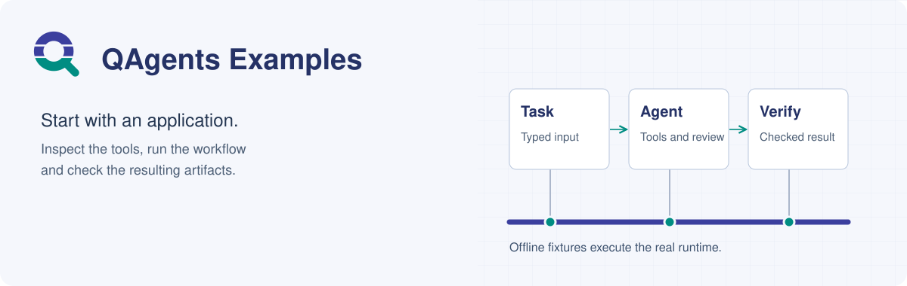

# QAgents Examples

Runnable applications built with QAgents, with checked inputs and local results.



Build useful agents with [QAgents](https://github.com/qagents-ai/qagents), starting with
credential-free examples you can inspect and test. Each application has its own
tools or structured task, input/output models and checks against application evidence.
Choose a configured OpenAI-compatible, Anthropic or QCloud model when you are ready.

[Browse the examples](#choose-an-application) · [Provider setup](docs/providers.md) ·
[Source map](docs/source-map.md) · [Verification](docs/verification.md)

## Start in a fresh workspace

Requires Python 3.11+, Git and [uv](https://docs.astral.sh/uv/).
These commands use a new parent directory, preserving
existing checkouts. The runtime is pinned in [QAGENTS_REVISION](QAGENTS_REVISION).

```console
mkdir qagents-demo-workspace
cd qagents-demo-workspace
git clone https://github.com/qagents-ai/qagents.git
git -C qagents checkout --detach db4813c15b4b6c6efa180a02df157ca115329d12
git clone https://github.com/qagents-ai/qagents-examples.git
cd qagents-examples
uv sync --locked --extra dev
uv run --locked qagents-examples list
uv run --locked qagents-examples run citation_research --output .runs/research-demo
uv run --locked qagents-examples run-all --output .runs/complete-demo
```

The last command runs every application and writes an `index.json`, per-agent
reports and local artifacts. Use a fresh output directory each time. Existing runs
are preserved. [Recorded outputs](samples/outputs) show an actual checked offline run.

Offline models provide explicit golden replies. The QAgents execution loop,
tool calls, SQLite writes, approvals, child agents and verifiers run normally.
These samples establish application behavior; they do not measure model quality.

## Choose an application

| Application | What it demonstrates | Guide |
| --- | --- | --- |
| [Citation research](src/qagents_examples/cases/citation_research.py) | Tool-based source collection and exact evidence quotes | [Run](docs/use-cases/citation_research.md) |
| [Customer support](src/qagents_examples/cases/support_case.py) | Triage handoff, customer authorization, approval and idempotent local case queue | [Run](docs/use-cases/support_case.md) |
| [Invoice audit](src/qagents_examples/cases/invoice_audit.py) | Typed extraction with independent line/total reconciliation | [Run](docs/use-cases/invoice_audit.md) |
| [SQL analyst](src/qagents_examples/cases/sql_analyst.py) | Read-only SQLite, bounded queries and checked business totals | [Run](docs/use-cases/sql_analyst.md) |
| [Lead qualification](src/qagents_examples/cases/lead_qualification.py) | Explainable rubric and an inbound-lead review artifact | [Run](docs/use-cases/lead_qualification.md) |
| [Meeting actions](src/qagents_examples/cases/meeting_actions.py) | Owners, dates and exact transcript evidence | [Run](docs/use-cases/meeting_actions.md) |
| [Flight planner](src/qagents_examples/cases/flight_planner.py) | Cheapest feasible route/date/budget selection | [Run](docs/use-cases/flight_planner.md) |
| [Recruitment evidence](src/qagents_examples/cases/recruitment_review.py) | Anonymous CV skill-mention worksheet for human review | [Run](docs/use-cases/recruitment_review.md) |
| [Expense review](src/qagents_examples/cases/expense_review.py) | Policy checks and approved local reimbursement queue | [Run](docs/use-cases/expense_review.md) |
| [Inventory planning](src/qagents_examples/cases/inventory_order.py) | Reorder arithmetic and approved purchase request | [Run](docs/use-cases/inventory_order.md) |
| [Code security review](src/qagents_examples/cases/code_security_review.py) | Source inspection without execution and explicit AST rules | [Run](docs/use-cases/code_security_review.md) |
| [Greek/English localization](src/qagents_examples/cases/greek_localization.py) | Specialist delegation, protected placeholders and glossary checks | [Run](docs/use-cases/greek_localization.md) |
| [Document questions](src/qagents_examples/cases/document_qa.py) | Local retrieval, evidence-only answers and abstention | [Run](docs/use-cases/document_qa.md) |
| [Editorial team](src/qagents_examples/cases/content_team.py) | An editor delegating through a writer to a researcher | [Run](docs/use-cases/content_team.md) |
| [KA220 proposal](src/qagents_examples/cases/grant_proposal.py) | Programme writer, independent budget reviewer and a complete illustrative draft | [Run](docs/use-cases/grant_proposal.md) |
| [Incident team](src/qagents_examples/cases/incident_team.py) | Internal messages across persistent coordinator/triager/reviewer inboxes | [Run](docs/use-cases/incident_team.md) |
| [Scoped preferences](src/qagents_examples/cases/scoped_preferences.py) | Approved memory surviving SQLite reopen with tenant/user isolation | [Run](docs/use-cases/scoped_preferences.md) |
| [Company analysis](src/qagents_examples/cases/company_analysis.py) | Durable workflow steps, worker-store reopen and replay without inference | [Run](docs/use-cases/company_analysis.md) |

## From a prompt to verified work


The model proposes an answer or action. Application code controls identities,
data access and destinations, then checks what happened. A well-shaped answer
can still fail: invented quotes, wrong arithmetic, changed plans and unsupported
claims are rejected. Approval decisions come from the application operator.

The following commands exercise a declined support case, a fictional KA220 draft
and a team exchanging persistent messages. A declined case leaves the local
destination unchanged:

```console
uv run --locked qagents-examples run support_case --approval decline --output .runs/declined-case
uv run --locked qagents-examples run grant_proposal --output .runs/ka220-draft
uv run --locked qagents-examples run incident_team --output .runs/incident-team
```

## Use your own input and model

Every guide links its [input fixture](samples/inputs). Pass another JSON object
with the same schema using `--input`. The same tools and verifiers run with
configured models; see [provider setup and pricing](docs/providers.md).

```console
uv run --locked qagents-examples run invoice_audit --input samples/inputs/invoice_audit.json --output .runs/invoice-check
```

OpenAI-compatible runs require explicit input/output prices for the dollar guard.
Anthropic uses the optional SDK; QCloud uses its SDK and catalog. Provider runs
default to interactive approval. Offline runs simulate approval unless you select
`--approval decline`. No example sends email, transfers money or changes a
production service.

## Where the examples came from

The examples draw on patterns from OpenAI Agents, CrewAI, Pydantic AI,
Microsoft AutoGen, Agno and smolagents. The
[source map](docs/source-map.md) links every application to immutable upstream
code and explains what was retained or changed. The [research catalog](research/sources.json)
records source hashes and observed repository license metadata.

These are original QAgents implementations, including new business adaptations
of general patterns. They are not feature-complete ports of the upstream services.
No upstream framework is required to run them. Local fixtures make the execution
and verification reproducible; production data clients are application integration work.

## Test and extend

To build your own application with Codex or Claude Code, start from the example
closest to your task. Connect the
[QAgents docs MCP server](https://github.com/qagents-ai/qagents/blob/main/docs/coding-agents.md)
and ask the assistant to read the installed API before editing. Keep the input
schema, tool permissions and result verifier specific to your application.

For example, extend the support case with another read-only lookup, then test
the new evidence alongside approved and declined actions. The
[contributor instructions](AGENTS.md) describe the checks each example must pass.

```console
uv run --locked pytest -q -W error
uv run --locked ruff check src tests scripts
uv run --locked python scripts/check_qagents_api.py
uv run --locked python scripts/build_docs.py --check
uv audit --locked
```

[Verification evidence](docs/verification.md) distinguishes offline/native checks,
local provider protocol tests and untested hosted services. The manual GitHub
workflow checks out the public runtime at the recorded revision.
The [contributor instructions](AGENTS.md) describe the execution contract.

Source for this collection and QAgents is available on GitHub. No package is
published to PyPI, and no open-source license is granted for this collection.
