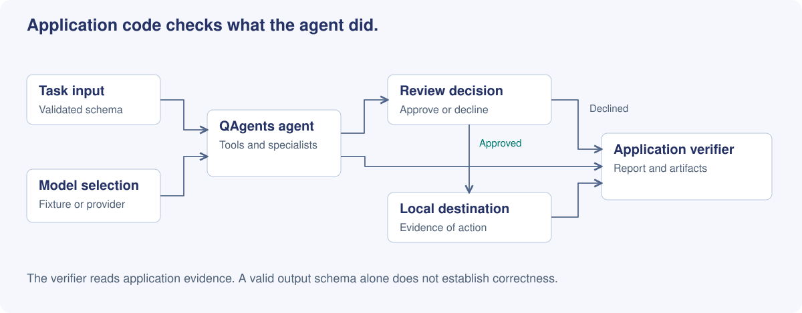

# An editorial team with specialist agents

An editor calls a writer, who calls a researcher with the source-reading tool.

[QAgents implementation](../../src/qagents_examples/cases/content_team.py) | [Example input](../../samples/inputs/content_team.json) | [Recorded output](../../samples/outputs/content_team/report.json)



## Run

From the checkout after the [setup](../../README.md#start-in-a-fresh-workspace):

```console
uv run --locked qagents-examples run content_team --input samples/inputs/content_team.json --output .runs/content_team-demo
```

Choose a fresh output path for every run. Offline mode supplies recorded model replies. QAgents still executes the tools, session journals and application checks. The [provider guide](../providers.md) shows how to use the same implementation with a configured model.

## What is checked

The title and every source paragraph remain intact. The parent usage includes all specialist model calls.

## Scope and limits

QAgents child tools replace distributed group chat. This fixture creates an evidence digest rather than evaluating creative writing quality.

Every agent has finite turns, tokens, tool calls and deadlines. A failed verifier or incomplete run returns a nonzero CLI exit. Local action tools pause for approval. Use `--approval decline` to inspect the refusal path.

## Inspected source

[microsoft/autogen · python/samples/core_distributed-group-chat/_agents.py](https://github.com/microsoft/autogen/blob/8390985108cb1e3881f5f7297765758d8ad2540c/python/samples/core_distributed-group-chat/_agents.py), [openai/openai-agents-python · examples/research_bot/manager.py](https://github.com/openai/openai-agents-python/blob/91fb508a8931016efa793b033147d08cd20308cf/examples/research_bot/manager.py)
